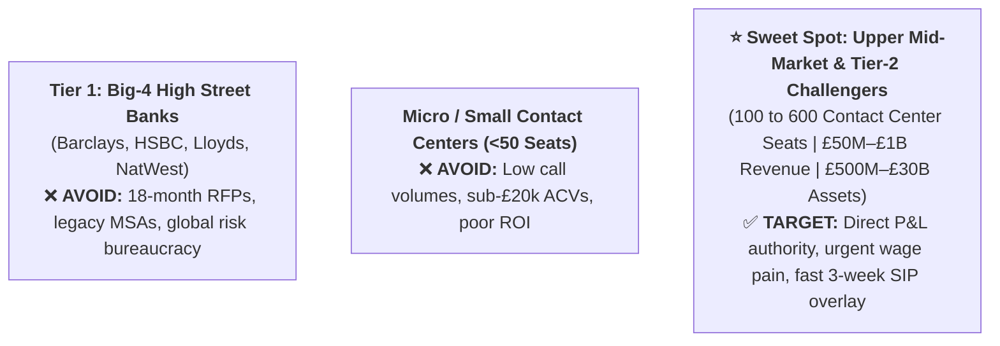
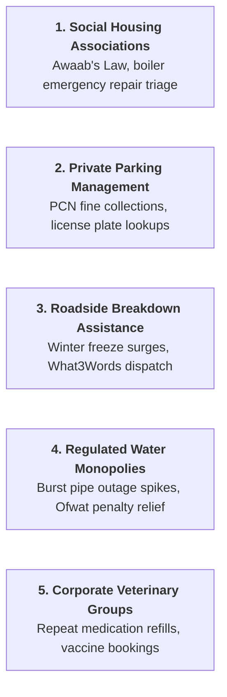

# UK Market Expansion Context: Strategy, Verticals, Accounts & Playbooks

> **EXECUTIVE CONTEXT & REFERENCE:**  
> This document is the comprehensive, authoritative operational record of **Gnani.ai’s UK Market Expansion Strategy**. It consolidates our market ranking analysis, target tier segmentation, sector-by-sector breakdowns, exemplar enterprise accounts, operational volumes, and cold outreach blueprints.

---

## 📑 Table of Contents
1. [Global Market Evaluation & Why the UK Ranks #1](#1-global-market-evaluation--why-the-uk-ranks-1)
2. [Target Tier Strategy: The Upper Mid-Market "Goldilocks Zone"](#2-target-tier-strategy-the-upper-mid-market-goldilocks-zone)
3. [The Core BFSI Sectors in the UK](#3-the-core-bfsi-sectors-in-the-uk)
4. [The 5 High-Volume "Overlooked / Odd" UK Niches](#4-the-5-high-volume-overlooked--odd-uk-niches)
5. [Universal Messaging Architecture & 2-Line Sector Pitches](#5-universal-messaging-architecture--2-line-sector-pitches)
6. [The 9 Handpicked Exemplar Companies: Deep-Dive Analysis](#6-the-9-handpicked-exemplar-companies-deep-dive-analysis)
7. [Spotlight Playbook: Parkingeye Limited](#7-spotlight-playbook-parkingeye-limited)
8. [Decision-Maker Persona Mapping & Rules of Engagement](#8-decision-maker-persona-mapping--rules-of-engagement)

---

## 1. Global Market Evaluation & Why the UK Ranks #1

When evaluating international expansion targets outside North America across the six candidate countries (**United Kingdom, Australia, Philippines, New Zealand, Indonesia, Vietnam**), the **United Kingdom emerged as the clear #1 priority**.

### Global Market Evaluation Matrix

| Rank | Country | Strategic Fit | Recommended Gnani Lead Products | Primary Conversion Wedge & Macro Drivers |
| :---: | :--- | :---: | :--- | :--- |
| **1** | 🇬🇧 **United Kingdom** | **9.6 / 10** | **Automate365™** + **Aura365™** + **Armour365™** | £6.50+ cost-per-call, strict FCA Consumer Duty compliance (100% QA audit requirement), sovereign private-cloud deployment via Gnani Artha. |
| **2** | 🇦🇺 **Australia** | **9.3 / 10** | **Automate365™** + **Assist365™** | Acute frontline wage inflation ($45–$65 AUD/hr), extreme labor shortages, and convenient India (IST) timezone overlap (+4.5 to +5.5 hours). |
| **3** | 🇵🇭 **Philippines** | **8.4 / 10** | **Assist365™** + **Aura365™** | Global BPO hub (1.5M+ agents); sell Agent Co-Pilot and 100% QA to BPOs (e.g. Concentrix proof point), and deflection to captive in-house shared centers. |
| **4** | 🇳🇿 **New Zealand** | **7.5 / 10** | **Automate365™** *(Bundle with Aus)* | High willingness to pay and English-native, but tiny total addressable market (5.2M pop); cluster into ANZ campaign. |
| **5** | 🇮🇩 **Indonesia** | **5.8 / 10** | **Automate365™** *(Collections/Fintech)* | High population and fintech growth, but requires Bahasa language model development and human labor cost is very low ($250–$400/month). |
| **6** | 🇻🇳 **Vietnam** | **3.9 / 10** | *Deferred / Do Not Pursue* | Tonal language with sharp regional dialect splits (no native model today); low frontline wages eliminate the ROI of voice deflection. |

### Why the UK is the Optimal Beachhead:
1. **Severe Economic ROI Drivers:** Frontline contact center salaries range from £26,000 to £36,000/year, driving an average cost-per-call of **£5.00 to £7.50 ($6.50–$9.50 USD)**. UK contact center leaders face intense board pressure to cut operating expenses without destroying CSAT.
2. **Zero Linguistic Friction:** 100% English-speaking. Gnani’s core acoustic engines and Evon v3.3 reasoning models deploy out of the box with zero regional language R&D.
3. **The "Sovereign AI / Artha" Competitive Moat:** 
   * UK financial and public institutions operate under strict **UK-GDPR** and **Financial Conduct Authority (FCA)** data residency requirements.
   * Competing U.S. voice wrappers (e.g., ElevenLabs + Vapi + Retell) route audio across multi-tenant U.S. cloud APIs, creating compliance risks.
   * Gnani’s **Artha sovereign architecture** allows enterprises to run full voice and reasoning pipelines within UK private clouds or on-prem with complete data residency.

---

## 2. Target Tier Strategy: The Upper Mid-Market "Goldilocks Zone"

Entering the UK as an overseas challenger requires deliberate prioritization of target tiers:

### Why We Target the Upper Mid-Market (100–600 Seats):
* **P&L Authority:** A **Director of Contact Centre**, **Head of Customer Operations**, or **COO** can approve a **£50k–£120k pilot** without a 15-person procurement committee.
* **Identical Wage Pain, Zero Engineering Staff:** They pay the exact same £30k/year agent salaries as the Big 4 banks, but lack the multi-million-pound internal AI engineering teams to build custom speech pipelines from scratch.
* **No Telephony Rip-and-Replace:** They cannot afford a 6-month CCaaS overhaul. Deploying a pre-packaged **carrier SIP overlay in under 3 weeks** directly solves their Q4/Q1 queue surges.

---

## 3. The Core BFSI Sectors in the UK

### A. Building Societies & Mutual Banks (The #1 Sweet Spot)
* **Sector Dynamics:** 42 mutual institutions managing >£500 billion in assets. Member-owned structure means cost-to-serve reductions directly improve member savings rates.
* **Customer Profile:** Skews older and affluent; heavily prefers phone calls over mobile banking apps.
* **Core Pain:** Huge seasonal call spikes during Bank of England base rate changes and the end of the tax year (March/April ISA rush). Hold times routinely hit 25–40 minutes.
* **Target Accounts:**
  1. **Coventry Building Society** (~£88B assets)
  2. **Yorkshire Building Society** (~£60B assets)
  3. **Skipton Building Society** (~£30B assets)
  4. **Leeds Building Society** (~£25B assets)
  5. **Principality Building Society** (~£11B assets)
  6. **Newcastle Building Society** (~£5B assets)
  7. **Nottingham Building Society** (~£4B assets)
  8. **West Bromwich Building Society** (~£6B assets)

### B. Specialist Lenders & Mortgages (NBFIs)
* **Sector Dynamics:** Non-bank financial institutions handling Buy-to-Let (BTL), bridging loans, contractor mortgages, and second-charge financing.
* **Telephony Split:** 50% intermediary brokers (*"Has underwriting signed off on valuation?"*) and 50% borrowers (*"What is my loan payoff / redemption figure?"*).
* **Core Pain:** Highly paid underwriters and senior servicing specialists spend 30–40% of their day answering repetitive status queries.
* **Target Accounts:**
  1. **Paragon Banking Group** (~£15B loan portfolio — FTSE 250 BTL leader)
  2. **OSB Group (OneSavings Bank / Kent Reliance)** (Major specialist residential lender)
  3. **Aldermore Bank** (Specialist retail & commercial mortgage lender)
  4. **Shawbrook Bank** (Property finance & SME specialist lender)
  5. **Close Brothers** (Merchant banking & premium motor finance)
  6. **Kensington Mortgages** (Specialist non-standard residential mortgages)
  7. **Pepper Money UK** (Second-charge & specialist lender)
  8. **MotoNovo Finance** (Vehicle finance specialist lender)

### C. Debt Purchase & Credit Management Agencies (DCAs)
* **Sector Dynamics:** DCAs purchase defaulted consumer debt portfolios from banks, telecoms, and utility providers.
* **Regulatory Climate:** Under intense scrutiny from the **FCA under Consumer Duty rules**; must identify vulnerable customers and maintain rigorous audit trails.
* **Core Pain:** Severe agent attrition from verbally hostile calls, plus high debtor drop-offs caused by the embarrassment of speaking with human collectors.
* **Target Accounts:**
  1. **Cabot Credit Management / Cabot Financial** (Includes Capquest & Marlin)
  2. **Lowell Group** (Leading UK debt purchaser for mobile, bank, and utility debt)
  3. **Arrow Global UK** (Specialist credit management)
  4. **PRA Group (UK)** (Major non-performing loan portfolio servicer)
  5. **Intrum UK** (Global credit management with major UK footprint)
  6. **Marston Holdings** (Judicial services & debt recovery)
  7. **Moorcroft Debt Recovery** (Mid-market UK collections)

### D. Mid-Market Motor & Personal Lines Insurance
* **Sector Dynamics:** High claims inflation and intense aggregator price competition (Comparethemarket, GoCompare).
* **Core Pain:** First Notice of Loss (FNOL) calls take 15 minutes of live agent data collection, costing £8.00–£12.00 per intake. Post-storm claims surges overwhelm phone queues.
* **Target Accounts:**
  1. **Hastings Direct** (3.5M+ live policies; Bexhill-on-Sea)
  2. **Sabre Insurance** (Specialist non-standard motor insurer)
  3. **Markerstudy Group** (Massive managing general agent; owns Budget Insurance & Dial Direct)
  4. **Esure** (Direct motor and home insurer)
  5. **Ageas UK** (Personal lines motor & home insurer)
  6. **Atlanta Group / Swinton / Autonet** (Leading personal lines broker network)

### E. Challenger Banks & Credit Card Servicers
* **Sector Dynamics:** Digital-first lenders and consumer credit card providers with 1M–5M cardholders running lean contact center operations.
* **Core Pain:** Repetitive inbound calls for card locks, PIN resets, payment date adjustments, and balance checks tying up Tier-2 specialists.
* **Target Accounts:**
  1. **NewDay** (Issues cards for John Lewis, Argos, Amazon UK, Aqua, Marbles)
  2. **Vanquis Banking Group** (Specialist credit cards and vehicle finance)
  3. **Zopa Bank** (Digital challenger bank, loans, and savings)
  4. **Chetwood Financial** (Digital specialist bank)
  5. **Tandem Bank** (Consumer loans and green mortgages)

---

## 4. The 5 High-Volume "Overlooked / Odd" UK Niches

Mainstream AI startups overlook these sectors because they appear operationally messy, unsexy, or quasi-public. However, they possess **massive phone call volumes**, **strict financial penalty exposure**, and **ample budgets**.

### 1. Social Housing Associations & Housing Trusts
* **The Call Driver:** Under statutory **Awaab’s Law** and Housing Ombudsman oversight, associations face heavy legal fines if emergency tenant repairs (broken boilers in freezing temperatures, severe plumbing leaks, toxic damp/mold) are not logged and triaged 24/7.
* **The Opportunity:** Morning queues blow out to 45-minute hold times. Callers are frantic tenants. Gnani triages severity, logs the repair directly into housing management systems (Civica, Orchard, Northgate), and collects phone rent payments.
* **Accounts:** Clarion Housing Group (125k homes), L&Q (105k homes), Peabody (104k homes), Places for People (240k homes), Sovereign Network Group (84k homes), Anchor (54k homes).

### 2. Private Parking Enforcement (PCN Collections)
* **The Call Driver:** Tens of millions of Parking Charge Notices (PCNs) issued annually. Motorists call to pay the discounted £60 fine before the 14-day statutory deadline expires and the fine jumps to £100.
* **The Opportunity:** Callers are angry and stressed; contact center agents suffer constant verbal abuse and quit frequently. Gnani takes the vehicle registration plate, quotes the discounted rate, executes an in-call PCI card payment, and texts a receipt in under 90 seconds (80%+ deflection).
* **Accounts:** ParkingEye, Euro Car Parks, APCOA Parking UK, NCP (National Car Parks), Horizon Parking.

### 3. Roadside Assistance & Breakdown Recovery
* **The Call Driver:** Winter freezes, sub-zero cold snaps, and holiday motorway gridlock create 10x sudden call volume spikes. Callers are stranded on dark, freezing motorway hard shoulders and cannot wait 45 minutes on hold.
* **The Opportunity:** Prisma v3.0 noise-resilient speech models cut through loud motorway traffic noise, capture exact vehicle registrations and location coordinates (postcode or What3Words), and trigger dispatch automatically.
* **Accounts:** The AA, RAC, Green Flag, Britannia Rescue, Call Assist (powers white-label rescue for 4M+ motorists).

### 4. Regulated Regional Water Utilities
* **The Call Driver:** When a water main bursts, 5,000 households lose water pressure simultaneously and all call at the exact same hour. Contact centers collapse, and the water regulator (**Ofwat**) levies multi-million-pound penalties for dropped calls.
* **The Opportunity:** Postcode-based incident recognition: *"We are aware of the burst main in CV1; engineers are on-site, estimated restoration is 2:00 PM."* Deflects 90% of panic traffic before reaching human agents.
* **Accounts:** Thames Water (16M customers), Severn Trent Water (8M customers), United Utilities (7M customers), Yorkshire Water (5.4M customers), Anglian Water, Southern Water.

### 5. Corporate Veterinary Clinic Networks
* **The Call Driver:** Over 60% of UK veterinary practices have been acquired by large corporate groups. Clinic receptionists and veterinary nurses are physically holding injured animals while front-desk telephones ring non-stop.
* **The Opportunity:** Over 40% of incoming calls are routine repeat prescription requests (flea/worming, chronic medication) and routine vaccination appointments. Gnani automates prescription intake for one-click vet authorization, silencing practice phones.
* **Accounts:** IVC Evidensia UK (1,000+ clinics), CVS Group plc (500 practices), Medivet (400+ practices), Vets4Pets (400+ clinics), Linnaeus Veterinary Group.

---

## 5. Universal Messaging Architecture & 2-Line Sector Pitches

### The Universal 3-to-4 Line Master Pitch:
> *"We deploy an in-house voice AI engine directly over carrier SIP into your existing systems in under 3 weeks—with zero telephony rip-and-replace.*  
> *Running at sub-200ms latency with zero awkward lag, our voice agents resolve 70%+ of your repetitive inbound calls and execute live transactions directly over the phone.*  
> *This slashes your cost-per-call by 60% (from £6.50+ down to under £0.80) while completely eliminating customer queue hold times."*

---

### Strict 2-Line Operational Pitches by Sector

* **1. Building Societies (Mutuals):**
  * *Use Case:* Authenticates members to resolve repetitive savings balance lookups, interest rate queries, and passbook maturity updates.
  * *Value:* Eliminates peak morning queue hold times without alienating older members by forcing them onto mobile apps.
* **2. Specialist Mortgage Lenders:**
  * *Use Case:* Automates broker pipeline application status checks and borrower loan payoff/redemption statement requests.
  * *Value:* Deflects 68% of routine servicing volume, freeing senior underwriters from answering repetitive telephone status questions.
* **3. Debt Collection Agencies (DCAs):**
  * *Use Case:* Negotiates promise-to-pay (PTP) agreements and collects card payments directly inside phone calls without agent transfers.
  * *Value:* Recovers millions in outstanding balances at 1/10th the collection cost while auditing 100% of calls for FCA Consumer Duty compliance.
* **4. Motor & Home Insurance:**
  * *Use Case:* Handles First Notice of Loss (FNOL) intake, claim status lookups, and proof of No-Claims Discount document dispatch.
  * *Value:* Slashes claims intake cost from £8.00 to under £1.00 while absorbing sudden call surges during storms and freezes.
* **5. Social Housing Associations:**
  * *Use Case:* Provides 24/7 emergency repair triage (logging boiler breakdowns, leaks, damp/mold) and collects rent over the phone.
  * *Value:* Eliminates severe regulatory fines for missed repair SLAs while cutting emergency out-of-hours call center costs by 50%.
* **6. Private Parking Management (PCNs):**
  * *Use Case:* Looks up parking ticket reference numbers by vehicle plate and takes fine card payments over the phone securely.
  * *Value:* Automates 85% of fine collections without human intervention, turning an angry bottleneck into instant recovered revenue.
* **7. Roadside Assistance & Breakdown:**
  * *Use Case:* Captures caller location (What3Words/postcode), car registration, and vehicle fault to dispatch recovery trucks immediately.
  * *Value:* Eliminates 45-minute hold times for stranded drivers during winter freezes, using noise-resilient speech AI.
* **8. Regulated Water & Regional Utilities:**
  * *Use Case:* Answers burst pipe outage inquiries by postcode, captures meter readings, and logs change-of-address moves.
  * *Value:* Absorbs sudden 10x call volume spikes during pipe bursts and avoids millions of pounds in Ofwat customer service penalties.
* **9. Corporate Veterinary Networks:**
  * *Use Case:* Automates repeat medication prescription refill orders, vaccine booking, and routine surgery check-in triage.
  * *Value:* Frees clinic receptionists from non-stop phone ringing so they can focus on in-person animal patient care.

---

## 6. The 9 Handpicked Exemplar Companies: Deep-Dive Analysis

| Industry | Target Company | Est. Annual Call Volume | Core Workflow Bottleneck | Does Gnani Actually Help? (The Reality) |
| :--- | :--- | :---: | :--- | :--- |
| **Building Societies** | **Skipton Building Society** | **1.2M – 1.8M** calls/yr | Member balance lookups, passbook updates, ISA tax deadlines. | **YES:** Eliminates 25-minute hold times during interest rate changes; saves ~£1.5M/yr in temp contact center staff without forcing older members into mobile apps. |
| **Specialist Lenders** | **Paragon Banking Group** | **600k – 900k** calls/yr | Broker application status checks and BTL redemption statement requests. | **YES:** Underwriters spend 30–40% of their day answering repetitive status queries from brokers. Deflecting 65%+ allows them to underwrite and close loans faster. |
| **Debt Collection** | **Lowell Group** | **3.5M – 5M** calls/yr | Debt validation, Promise-to-Pay (PTP) agreements, and card payments. | **YES:** Debtors feel ashamed talking to human collectors (causing high drop-offs). Empathetic Voice AI boosts repayment plan setups by 18–25% and protects agents from verbal abuse. |
| **Motor Insurance** | **Hastings Direct** | **3.5M – 4.5M** calls/yr | FNOL accident intake and garage repair status checks. | **YES:** Live agent FNOL takes 15 minutes and costs £8–£12. Gnani collects details conversationally in 3 minutes for <£1, providing immediate post-accident triage. |
| **Social Housing** | **Clarion Housing Group** | **1.8M – 2.5M** calls/yr | 24/7 emergency repair logging (boiler breakdowns, leaks, damp). | **YES:** Protects Clarion from statutory fines under Awaab’s Law by answering instantly, logging repair tickets into ERP, and eliminating 45-minute winter queue holds. |
| **Parking Management** | **ParkingEye** | **1.5M – 2.2M** calls/yr | Motorists paying discounted £60 PCN fines before the 14-day deadline. | **YES:** Frontline agents quit over relentless verbal abuse from angry motorists. Automated in-call PCI card payment deflects 80%+ of queue traffic in 90 seconds. |
| **Roadside Assistance** | **Call Assist** | **2.0M – 3.0M** calls/yr | Emergency breakdown intake and recovery truck dispatch. | **YES:** Directly addresses life safety. Stranded drivers in sub-zero motorway conditions get answered on the 1st ring, GPS coordinates logged, and recovery dispatched 20 mins faster. |
| **Water Utilities** | **Severn Trent Water** | **3.0M – 4.0M** calls/yr | Sudden burst pipe call surges and meter reading submissions. | **YES:** When a pipe bursts, thousands call simultaneously. Postcode-based IVR deflection answers instantly with incident status, deflecting 90% of panic calls and avoiding Ofwat penalties. |
| **Veterinary Networks** | **IVC Evidensia UK** | **5.0M – 7.0M** calls/yr *(across 1,000 clinics)* | Repeat prescription requests, flea/worming orders, vaccine appointments. | **YES:** Routine prescription refills account for 40%+ of calls. Automating this silences ringing phones in clinics, allowing nurses and receptionists to focus on clinical animal care. |

---

## 7. Spotlight Playbook: Parkingeye Limited

### Company Snapshot:
* **Entity:** Parkingeye Limited (Subsidiary of Agena Group, formerly Capita Parking Services)
* **Registered Office:** 40 Eaton Avenue, Matrix Park, Buckshaw Village, Chorley, Lancashire, PR7 7NA
* **Footprint:** The UK market leader in Automated Number Plate Recognition (ANPR); manages **3,500+ commercial car parks** across supermarkets (Aldi, Morrisons), NHS hospital trusts, hotels, and shopping centers.
* **Volume:** Issues millions of Parking Charge Notices (PCNs) each year.

### Who to Target (and Who to Avoid):
* ❌ **AVOID: The CEO (Phil Boynes)**  
  * *Why:* CEOs at £50M+ operations delete or ignore cold technology tools because they do not feel the day-to-day contact center queue pain.
* ✅ **TARGET: Head of Customer Operations / Head of Contact Centre Services**  
  * *Why:* This functional leader owns the call queue SLAs, deals with 40%+ frontline agent attrition from hostile callers, and gets scrutinized when Monday morning hold times blow out. If you offer them a low-risk 1-week sandbox POC with zero sales push, they have the authority and motivation to test it.

---

### The High-Impact Cold Email (76 Words)

> **Subject:** Parkingeye / automating £60 PCN payment queues
>
> Hi {{firstName}},
>
> Having human agents absorb angry calls just to collect a discounted £60 PCN is burning out your frontline.
>
> We run an in-house voice engine at sub-200ms latency that captures vehicle registrations and settles PCI card payments directly on the call in 90 seconds—deflecting 80% of payment queue volume.
>
> We power 30M+ enterprise calls daily. Could we build a 1-week sandbox POC on your flow so you can test the builder yourself? No sales push.

---

### Strategic Teardown: Why This Email Triggers Engagement:
1. **The Visceral Opening Nerve:** *"Having human agents absorb angry calls just to collect a discounted £60 PCN is burning out your frontline."*  
   Instantly validates the recipient's daily operational frustration. They hate seeing agents quit because of verbal abuse over parking charges.
2. **Specific Operational Metric:** *"settles PCI card payments directly on the call in 90 seconds—deflecting 80% of payment queue volume."*  
   Communicates a bounded, concrete operational solution rather than generic "AI customer service."
3. **Technical Credibility Without Lag:** *"sub-200ms latency"* + *"30M+ enterprise calls daily."*  
   Signals that this is not an awkward, lagging 2-second wrapper bot that talks over callers, and proves production-grade enterprise scale.
4. **The Builder Sandbox Offer:** *"Could we build a 1-week sandbox POC on your flow so you can test the builder yourself? No sales push."*  
   Removes defensive sales friction. Operations leaders appreciate hands-on access to test and configure the workflow in a private sandbox rather than sitting through slide decks.

---

## 8. Decision-Maker Persona Mapping & Rules of Engagement

### Target Job Titles in the UK:
* **Primary Target:** Head of Customer Operations, Director of Contact Center, Head of Customer Experience (CX).
* **Secondary Target:** Chief Operating Officer (COO), Head of Lending Operations (for Mortgage lenders), Director of Collections (for DCAs), Head of Member Services (for Building Societies).
* **Technical Evaluators:** Head of Telephony, Voice Infrastructure Architect, CCaaS Platform Lead.

### Strict Outreach Directives:
* ❌ **NEVER use generic openers:** *"Did I catch you at a bad time?"* or *"Are you looking to implement AI?"*
* ❌ **NEVER describe Gnani as an "AI chatbot":** We deploy sovereign Voice AI engines and agentic transaction workflows over carrier SIP.
* ❌ **NEVER suggest a 6-month telephony overhaul:** Position as a **3-week SIP overlay** into existing CCaaS routing (Genesys, Cisco, Avaya) with zero rip-and-replace.
* ✅ **ALWAYS lead with hard operational benchmarks:** 70%+ routine queue deflection, 60% reduction in cost-per-call, sub-200ms conversational latency, and in-call PCI transaction completion.
